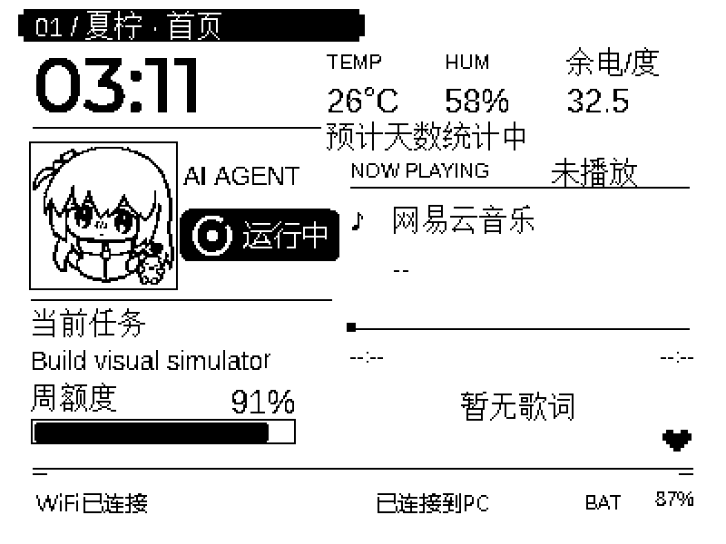

# 夏柠 · ESP32 RLCD 桌面助手

基于微雪 **ESP32-S3-RLCD-4.2** 的 400×300 黑白屏桌面助手，配套 Windows / macOS Reporter。

**源码版本：1.0.0-rc.3 · 2026-10-20**。这是玉米维护的定制版，程序内部版本暂沿用 1.0.0。本次 Release 提供完整项目源码和校验清单，安装器、预编译固件另按构建说明生成。

[下载源码](https://github.com/yumi233/Waveshare_ESP32_RLCD/releases/tag/v1.0.0-rc.3) · [功能索引](docs/FEATURES.md) · [构建说明](docs/BUILD.md) · [更新记录](CHANGELOG.md) · [本版说明](docs/RELEASE_NOTES_1.0.0-rc.3.md)

> 预览使用示例数据。新启用时预计天数显示“统计中”，积累至少 24 小时有效用电记录后才计算。

## 按功能查看

| 功能 | 本版内容 | 说明 |
| --- | --- | --- |
| 设备界面与开屏 | 夏柠开屏、像素装饰、角色头像、留白排版、按键操作 | [页面与按键](docs/features/UI_AND_BUTTONS.md) |
| 首页 Agent 区域 | 任务＋周额度、短周期＋周额度、仅任务，可在设置页切换 | [界面设计](docs/UI_REDESIGN_EDITORIAL.md) |
| Codex 状态与额度 | 原生 CLI 优先、App Server 长连接、登录识别、缓存与恢复 | [Reporter 与额度](docs/features/CODEX_AND_REPORTER.md) |
| 宿舍用电 | 五邑大学余电、累计用电，首页显示预计可用天数 | [用电与充值](docs/ELECTRICITY_RECHARGE.md) |
| 低余电提醒 | 默认 ≤10 度，电脑和 RLCD 显示学校待支付码，100 / 50 元可选 | [配置与操作](docs/ELECTRICITY_RECHARGE.md) |
| 待机优化 | 发现周期 5 秒、相同画面跳过 SPI、15 秒电池采样缓存 | [省电改动](docs/features/POWER.md) |
| 电脑性能与音乐 | CPU / GPU / 内存 / 磁盘 / 网络、网易云音乐与歌词 | [macOS](reporter/MACOS.md) / [Windows](reporter/WINDOWS-UI.md) |
| 语音与电脑绑定 | “你好夏柠”、单轮问答、局域网发现与电脑选择 | [固件](xiaozhi/README.md) / [通信接口](docs/PROTOCOL.md) |

## 开始使用

1. 确认硬件为 ESP32-S3-RLCD-4.2，**16 MB Flash、8 MB PSRAM**，按 [构建说明](docs/BUILD.md) 生成固件。升级前备份 Flash 并核对分区。
2. 在电脑启动 Reporter，与设备连接到可互访的局域网。macOS 应用驻留菜单栏，不占 Dock；关闭状态窗口仍继续采集。
3. 设备先按住 BOOT，再同时长按 KEY 约 3 秒进入设置页，配置 Wi-Fi 和首页显示模式。
4. 如需宿舍用电，在设备设置页和电脑「电费 / 充值」中填写**相同的楼栋与房间**。公开源码默认未配置宿舍，不包含私人配置。
5. 余电达到提醒阈值时自动显示充值页，也可在宿舍用电页按 BOOT 打开。实际付款由用户扫码完成。

学校接口可能需要校园网，变更后也可能暂时不可用。首次用电天数估算需要至少 24 小时记录；设备电池续航不参与该估算。充值提示、设置窗口目前在 **macOS** 实现，Windows 新界面尚未做本版集成验收。

## 源码结构

| 目录 | 内容 |
| --- | --- |
| `xiaozhi/` | 固定上游版本、板级源码、补丁和 ESP-IDF 构建入口 |
| `reporter/` | 状态采集、额度通信、用电服务、桌面窗口与回归测试 |
| `simulator/` | LVGL 模拟器、同源 UI、字体与素材 |
| `installer/` | Windows / macOS 安装器源码 |
| `tests/` | 固件界面、按键和状态逻辑主机测试 |
| `docs/` | 功能说明、协议、构建、预览与验收记录 |
| `release/` | 源码打包、校验与签名工具、第三方许可材料 |

固件基于 ESP-IDF **6.0.2** 和锁定的小智提交；模拟器使用 LVGL **9.5.0**。上游依赖、构建缓存、运行配置或整片设备备份不混入源码包。

## 验证范围

本版验证记录见 [发布验证](docs/RELEASE_VALIDATION_2026-10-20.md)。2026-10-10 的固件曾完成 USB 写入校验、启动、联网及音频初始化检查；持续续航、扫码后的真实支付到账及其他电脑兼容性不以单元测试代替。历史 Windows 验收见原有发布记录，本版没有生成新的 Windows 安装包。

## 作者与许可

- **原项目作者：[黑沐 / heimumumu](https://github.com/heimumumu)**，原项目：[Waveshare_ESP32_RLCD](https://github.com/heimumumu/Waveshare_ESP32_RLCD)。
- **界面重构与功能定制：[玉米 / yumi233](https://github.com/yumi233)**，本仓库：[yumi233/Waveshare_ESP32_RLCD](https://github.com/yumi233/Waveshare_ESP32_RLCD)。
- 小智底座、LVGL、字体、语音模型及其他依赖保留各自版权和许可证，详见 [LICENSE](LICENSE) 与 [第三方说明](THIRD_PARTY_NOTICES.md)。
- 用户选定的《孤独摇滚！》后藤一里角色头像及其像素转换不适用根目录 MIT，其相关权利归原权利人；本仓库不将角色素材宣称为原创或已获 MIT 授权。
