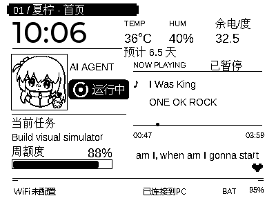
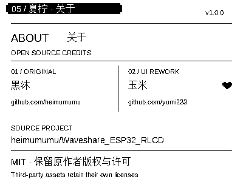

# UI-01 / UI-02 · 页面与按键

## 页面

- 开屏：夏柠名称、角色头像与启动提示。
- 首页：时间、温湿度、宿舍余电、预计天数、Agent 状态、任务 / 额度、音乐与连接状态。
- 性能：CPU / GPU / 内存 / 磁盘、温度、网络与走势图。
- 夏柠：最近一轮对话、待办和 API 余额。
- 宿舍用电：房间、余电、累计用电、预计天数与充值入口。
- 电脑选择：附近 Reporter、在线状态、当前选择。
- 关于：原项目作者黑沐、界面重构与定制者玉米、许可提示。

普通页面由 KEY 翻页，电脑选择和充值页有单独的按键处理。400×300 单色画面使用纯黑白像素，动态文字与底图分开，预计天数独占一行。角色素材的权利说明见 [第三方声明](../../THIRD_PARTY_NOTICES.md)。

## 按键

| 场景 | KEY 短按 | KEY 长按 | BOOT 短按 |
| --- | --- | --- | --- |
| 普通页 | 下一页 | 打开电脑选择 | 启动 / 停止语音会话 |
| 电脑选择 | 下一台电脑 | 返回首页 | 确认选择，空列表不会启动语音 |
| 宿舍用电 | 下一页 | 打开电脑选择 | 打开充值页 |
| 充值页 | 下一项：100 元、50 元、查询、稍后 | 关闭本次提醒 | 确认当前项 |

先按住 BOOT，再同时长按 KEY 约 3 秒进入设备设置页。组合键会抑制普通翻页、电脑选择和语音操作。电源按键行为由板级电源管理控制，具体见 [微雪硬件说明](https://www.waveshare.net/shop/ESP32-S3-RLCD-4.2.htm)。

## 首页模式

设置页的「首页 Agent 信息」可选：

- `task_week`：当前任务与周额度。
- `quotas`：短周期与周额度，短周期标签沿用“五小时”。
- `task`：仅任务。

账户没有某个限额窗口时该项显示 `--`，不会补造五小时额度。保存后生效，无需为切换模式重新刷机。

## 修改入口

- 布局：`simulator/src/ui/ui.c`；设备对应 `xiaozhi/overlay/.../ui.c`，两者正文保持同步，仅 include 路径不同。
- 头像：`simulator/assets/source/user_character/avatar-user-selected-80.png` 与两份 `ui_character_avatar.c`。
- 按键路由：板级 `waveshare-s3-rlcd-4.2.cc`、`custom_lcd_display.cc`。
- 配置项：`settings_portal_service.cc`。

模拟预览见 [首页](../previews/home-electricity-estimate.png)、[充值页（DEMO）](../previews/electricity-recharge-demo.png)。预览数据是示例，二维码不可用于实际付款。

## 本版渲染预览

